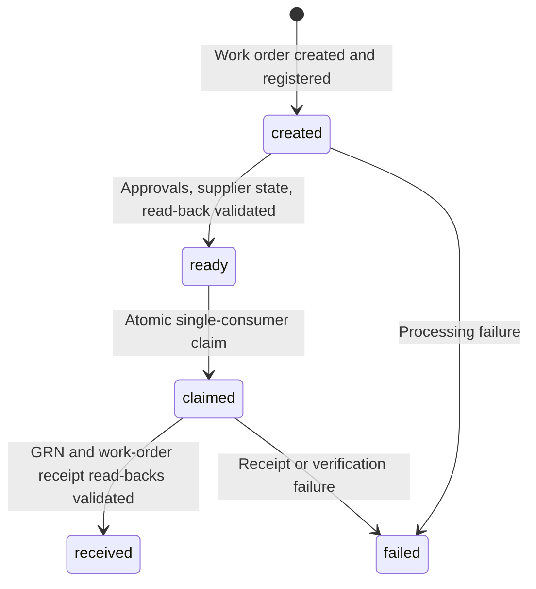

# Independent concurrent role load tests

`k6/scenarios/load-roles.js` implements Approach B: Merchandiser and Inventory run as independent `ramping-vus` scenarios. Existing full-journey and arrival-rate scenarios remain available with their original behavior. The `test:load:5` and `test:loads:10/20/50` npm commands also select this role-based scenario. Separate per-user load files and partial linked-journey entrypoints were removed; feature smoke tests remain available for diagnosis.

## Workflows and handoff

Merchandiser creates style → tech pack/uploads → sample → BOM → pre-costing → purchase order → work order. Only work-order approval is required: the senior-merchandiser account approves the created work order and transitions it to `SENT_TO_SUPPLIER`. A read-back validates that status and the created style/purchase relationships before handoff. Inventory also requires `SENT_TO_SUPPLIER` and zero received quantities before sending a GRN. BOM, costing and purchase-order approvals/submissions remain excluded.

Inventory claims one current-run order, retrieves it from the application, verifies every variant and measurement unit, and checks that no prior GRN exists. It receives the full ordered quantities for all variants, rather than the legacy fixture's fixed 120 units for one variant. It then reads back the GRN, verifies work-order received quantities/status, and confirms exactly one GRN for the order. Any prerequisite/relationship/quantity failure stops that workflow.

QC is not implemented and is excluded from this flow: no inspection request is sent and no QC pass status is required or fabricated. Inventory work is limited to receiving items. Stock-entry creation and stock-added quantity checks are also excluded. Receiving verifies GRN quantities, work-order state, and receipt uniqueness. The scenario needs `accessory-grn.create/read` and `work-order.read` permissions and their implemented features.

The smoke run stops automatically on workflow failure (`ROLE_STOP_ON_ERROR=1`), after preserving its ledger. See [the inspection investigation](k6-inspection-investigation.md) for the earlier QA failure and partial receipt requiring reconciliation. Inspection is no longer a prerequisite for this test.

The local OpenAPI specification documents work-order list/detail APIs, GRN list/detail/create, inspections, and stock entries. It does **not** document an atomic receiving claim. Work-order number reservation reserves a new number, not an Inventory claim. A mutable JavaScript global or `SharedArray` cannot coordinate independent VUs.

The Node runner consequently starts a small loopback-only coordinator with a random per-run key. No Redis, database, cloud account, or additional package is required. Merchandisers register only IDs created during this run; Inventory discovers those IDs through the coordinator and verifies them using application GETs. The coordinator serializes claims and writes `handoff-ledger.json` atomically before acknowledging transitions:



Claims never expire or automatically return to the queue. An HTTP timeout, 401, 409, 429, 5xx, or interrupted POST may have committed a non-idempotent operation. The script never retries create/receive writes. Failed or interrupted claims remain failed/claimed in the ledger and backlog. Reconcile them with application records before taking any manual recovery action. A lost claim response can leave a claimed order; it is retained, not reassigned.

The coordinator is authoritative for **one local Node runner and its k6 process**. Restart/resume, distributed/cloud k6 workers, and concurrent runs using the same accounts are not supported. Its key is not written to reports or the ledger. Application processing by users outside this test is not protected by the coordinator; use dedicated accounts and an isolated seeded QA tenant. Duplicate GRN read-backs and nonzero initial received quantities detect observable interference.

## Credentials and prerequisites

The runner loads root `.env` as before; exported values take precedence. No credentials or environment files were changed. The root configuration currently contains `MERCHANDISER_ACCOUNT_COUNT=50` and `INVENTORY_ACCOUNT_COUNT=12` with numbered `*_ACCOUNT_<n>_EMAIL/PASSWORD` entries. The new scenario prefers this declared pool. Where it is absent, it supports the explicit account mappings in `k6/data/users.json`.

For a 50-VU test, 40 distinct Merchandiser and 10 distinct Inventory identities are required. Duplicate identities across selected accounts, blank variables, or insufficient accounts fail before business traffic. The coordinator assigns each business VU a stable role-account index without assuming global VU IDs are contiguous within a scenario.

Setup authenticates only selected accounts sequentially using the existing bounded 429 handling. Sessions are reused. `ROLE_SESSION_MAX_AGE_SECONDS` controls proactive renewal at a workflow boundary. An expired session/401 fails the current dependent operation and invalidates the local token; the next safe workflow boundary renews it. Failed writes are never replayed. Login failures abort setup or fail the affected VU workflow. Raw response bodies, passwords, cookies, and tokens are omitted from diagnostics.

Role runs default to `LOGIN_DELAY_SECONDS=5` between accounts and `LOGIN_RETRY_BASE_SECONDS=30` for a 429 without a usable `Retry-After` header. Fallback cooldown doubles per retry (30s, then 60s with the default two retries). A valid server `Retry-After` is respected, with at least the inter-account delay. A wait above `LOGIN_MAX_RETRY_WAIT_SECONDS` (default 120s) fails instead of retrying early. Existing environment values override these defaults. These are starting settings, not measured server limits. Setup may take several minutes at maximum load and remains outside the timed business workload.

If setup is rate-limited, increase login pacing deliberately, for example `LOGIN_DELAY_SECONDS=10 LOGIN_RETRY_BASE_SECONDS=60 npm run test:roles:smoke`. Do not disable server throttling or repeatedly restart a failing test. A setup failure leaves the business result incomplete; a very short failed run may not produce dashboard HTML even though the stakeholder PDF is generated.

Before live execution, check:

- `BASE_URL`, `LUMINAR_FACTORY_ID`, `LUMINAR_ORGANIZATION_ID`, `LUMINAR_BUYER_ID`, `LUMINAR_PAYMENT_PROVIDER_ID` match the seeded QA tenant.
- Style size template, BOM measurable items, work-order suppliers/variants/groups, units, and binary upload fixtures are valid in that tenant. These are existing fixtures; their business validity cannot be established by static parsing alone.
- Sample due/collection dates, work-order delivery dates, and the selected shipment date satisfy current business rules. Shipment dates are generated from the explicit relative-date rule in `k6/data/purchase.json`: today in Asia/Dhaka (UTC+06:00) plus 30 calendar days. Maintain the other fixture dates deliberately.
- Merchandiser and Inventory accounts have the required permissions.

`LUMINAR_SHIPMENT_DATE` is no longer required or used. `purchase.json` supplies the shipment-date rule, and the payload builder resolves it at execution time. For example, October 16, 2026 resolves to November 15, 2026.

**Contract discrepancy requiring live confirmation:** existing `flows/pre-costing.js` uses style-level `/api/v1/styles/{id}/costings` routes. The supplied OpenAPI snapshot records purchase-order-level costing routes. The new scenario retains the existing helper and workflow order rather than inventing a replacement. Verify this route and approval prerequisites on QA before trusting results.

The current QA purchase-order API also requires a top-level `currency`, separately from shipment-item `unitPriceCurrency`. Keep the supported currency in `k6/data/purchase.json` (`USD` by default). This field is absent from the older OpenAPI snapshot; its omission was reproduced as HTTP 400, and the corrected request was verified with HTTP 201. See the [purchase-order investigation](k6-purchase-order-investigation.md).

Work orders likewise require top-level `currency` in `k6/data/work-order.json`. When linking a newly created purchase order, the helper reads its actual style/size/color rows, derives garment counts and material quantities from consumption/wastage, and omits stale fixture grouping UUIDs before reserving a number. Missing or ambiguous garment matches fail locally. This corrected work-order request and its saved relationships/quantities were verified in QA; see the [work-order investigation](k6-work-order-investigation.md).

## Commands

Run from the repository root after installing pinned dependencies with `npm ci` and supplying the prerequisites above:

```bash
# 1 Merchandiser + 1 Inventory, at most one producer workflow, human delays disabled:
npm run test:roles:smoke

# 8 Merchandisers + 2 Inventory:
npm run test:loads:10

# 16 Merchandisers + 4 Inventory:
npm run test:loads:20

# 40 Merchandisers + 10 Inventory, 15-minute steady phase:
npm run test:loads:50
```

Validate handoff at low load, then 10 → 20 → 50 separately after failures and data conditions are understood. These commands are alternatives, not an automatic sequence. A successful tiny smoke does not establish 50-VU capacity.

The smoke command disables human think time to check wiring and caps producer workflows at one. Its 30-second steady phase plus two-minute producer grace and 30-second drain keeps Inventory available for in-flight work; Inventory ramp-down/grace can extend the wall time. For realistic smoke pacing, use the general runner with two users and its longer defaults:

```bash
ROLE_TOTAL_VUS=2 npm run test:roles

# Custom allocation and schedule (counts must sum to the total):
ROLE_TOTAL_VUS=20 ROLE_MERCHANDISER_VUS=15 ROLE_INVENTORY_VUS=5 \
  ROLE_RAMP_UP=2m ROLE_STEADY=15m ROLE_RAMP_DOWN=2m npm run test:roles

# A deliberately selected dotenv file must contain a complete compatible configuration:
node --env-file=.env.qa k6/reporting/run.mjs load-roles

# Dashboard HTML export without opening a live dashboard server:
K6_WEB_DASHBOARD_PORT=-1 npm run test:loads:10
```

Use `ROLE_*` settings rather than `K6_VUS`, `K6_STAGES`, segmentation, or other workload overrides. The runner rejects those overrides for this scenario. Direct `k6 run` lacks the coordinator lifecycle; use the Node/npm runner.

## Configuration

| Variable | Default | Meaning |
| --- | --- | --- |
| `ROLE_TOTAL_VUS` | `10` | Combined peak, integer 2–50 |
| `ROLE_MERCHANDISER_VUS`, `ROLE_INVENTORY_VUS` | For total 2/5/10/20/50: 1+1 / 4+1 / 8+2 / 16+4 / 40+10 | Explicit positive integers required for other totals; sum must match total |
| `ROLE_RAMP_UP`, `ROLE_STEADY`, `ROLE_RAMP_DOWN` | `2m`, `15m`, `2m` | Producer schedule; total 2 defaults to `1s`, `10m`, `1s` unless overridden by the smoke command |
| `ROLE_GRACE`, `ROLE_DRAIN` | `10m`, `5m` | Maximum producer completion grace and extra Inventory drain time |
| `ROLE_RUN_ID` | Generated UUID-based ID | 1–40 letters/digits/hyphens; fresh identifiers recommended |
| `ROLE_MAX_WORKFLOWS_PER_VU` | `0` | Optional per-producer attempt cap; 0 means unlimited; smoke command sets 1 |
| `ROLE_THINK_SCALE` | `1` | Multiplier for randomized human delays; 0 disables them |
| `ROLE_SESSION_MAX_AGE_SECONDS` | `900` | Renew sessions at safe workflow boundaries after this age |
| `ROLE_POLL_TIMEOUT_SECONDS`, `ROLE_POLL_INTERVAL_SECONDS` | `60`, `2` | Bounded application read/state polling and idle queue polling interval |
| `ROLE_API_P95_MS`, `ROLE_API_P99_MS` | `2000`, `5000` | Provisional application HTTP targets |
| `ROLE_HTTP_FAILURE_RATE` | `0.01` | Application HTTP failure rate must be below this value |
| `ROLE_COMPLETION_RATE` | `0.99` | Receipt-verified workflows / all attempted workflows must be at least this value |

Each scenario's peak is bounded by its role allocation; the two peaks sum to at most 50, including retiring VUs. Inventory stays at its allocated count through producer ramp-down, producer grace, and drain before ramping down itself. This maintains consumers while producers finish. Any remaining backlog still counts as unreceived; draining does not redefine it as success.

Configure randomized human delays with `ROLE_THINK_<ACTION>_MIN` and `ROLE_THINK_<ACTION>_MAX`, in seconds:

| Action | Default seconds |
| --- | --- |
| `LOGIN` | 2–5 |
| `STYLE` | 15–45 |
| `TECHPACK` | 20–60 |
| `SAMPLE` | 20–60 |
| `BOM` | 30–90 |
| `COSTING` | 20–60 |
| `PURCHASE` | 15–45 |
| `DISCOVER` | 5–20 |

These are assumptions to replace with observed behavior. Delays follow business actions; they do not stand in for API responses or asynchronous state checks. Only safe GETs are polled for transient failures/state readiness. `Retry-After` is respected within the configured polling deadline. There is a short backoff after failed iterations to avoid retry storms, and idle Inventory VUs wait between queue checks.

## Metrics, dashboard, and reports

Load runs automatically open the standard k6 dashboard at `http://localhost:5665`. Close its browser tab when the test finishes so k6 can exit and finalize reports. `K6_WEB_DASHBOARD=false` disables it; `K6_WEB_DASHBOARD_PORT=-1` exports HTML without a live dashboard server.

The runner loads `k6/config/dashboard.json` using k6's native `XK6_DASHBOARD_CONFIG` option. This works around a reproduced k6 2.2.0 embedded UI crash (`Cannot convert undefined or null to object`) when new chart series appear after authentication setup. HTTP request rate, latency, and failure graphs remain time series. VUs, iteration duration, network throughput, and business counters use native stat panels so their late appearance does not clear the page. Metrics and acceptance thresholds are unchanged. The Summary tab and exported dashboard report use the same layout.

An explicitly configured `XK6_DASHBOARD_CONFIG` or repository-root `.dashboard.json` takes precedence. Custom layouts can reintroduce the crash if charts gain series after they first render. Restart the test and reload the dashboard after changing its configuration; an already-running k6 process retains its original layout. This workaround was browser-tested against a local synthetic workload, without QA traffic.

Every Node run produces the existing PDF/HTML reports, summary JSON when available, metadata, dashboard export, and `handoff-ledger.json` under a unique `k6/results/` directory. The ledger retains every started producer workflow, known created entity IDs (including partially failed flows), order relationships, claim ownership, state, timestamps, and sanitized failure categories. There is no automatic recovery/replay from this file.

Endpoint summaries include request counts/rates, average, p90/p95/p99, and HTTP errors. Functional check counts remain visible. Business metrics include:

- `merchandiser_attempted/completed/failed`, `merchandiser_success`, and elapsed producer duration.
- `created_work_orders`, `claimed_work_orders`, `inventory_completed/failed`, `inventory_success`, and `inventory_empty_polls` for producer/consumer activity.
- `workflow_step_failed` with role/step tags and sanitized HTTP/category information in the ledger/report.
- Final reconciled `received_work_orders`, `pending_work_orders`, `unreceived_work_orders`, and `e2e_success` against **all started producer workflows**, including partial failures and unfinished workflows.
- `e2e_elapsed_duration` and `work_order_to_receipt_duration` for successfully verified receipts, including think time/queue waiting. Latencies for incomplete workflows are not included in these success-duration distributions.
- `business_operation_duration` by step, including client processing, uploads, and read polling. HTTP durations are measured separately; neither metric is server-internal processing time.
- `incorrect_inventory_quantities`, `duplicate_successful_receipts`, `duplicate_receiving_attempts`, `data_integrity_violations`, and `coordination_errors`.

Quantity/integrity/duplicate-success counters must be zero; at least one producer attempt and a verified received order are required. Reports fail if ledger completion falls below the configured rate, even if finished-attempt metrics look healthy. Missing final reconciliation is incomplete, not passing. Empty polls are reported separately from failed receiving operations. Authentication/permissions, validation/test-data responses, conflicts, throttling, backend failures, and script/polling failures require different investigations; an HTTP 400 alone does not prove a server performance defect.

Application HTTP thresholds use `traffic:application` and exclude coordinator requests and initial authentication setup. Aggregate HTTP totals include both, so use the application-scoped metrics and endpoint metrics for API analysis. k6's generic dashboard totals also include coordinator calls. Setup login metrics remain available by operation name. Aggregate results cover ramps and drain, not only steady state. Correlate with server/database/storage and generator telemetry before naming a bottleneck.

## Data management and validation

Style names, buyer PO numbers, GRN numbers, identify the run where the existing contracts support it; linked IDs and the ledger identify remaining entities. The test creates persistent records and uploads real fixture files. There is no complete safe teardown API in this suite. Reset only the approved disposable QA seed snapshot and test storage prefix through the environment's existing process, preserving the ledger for reconciliation. Do not delete ordinary users' data or silently rerun failed receipts.

Run `npm run test:reporting` for offline checks. They validate allocation limits, credential selection, claim concurrency, failure retention, quantities/relationships, safe session renewal, failed-step behavior, report assessment, k6 scenario parsing, PDF/dashboard exports, and actual isolated k6 VUs handing off **synthetic** orders through the local coordinator. These are tooling tests, not proof that Luminar accepts the business payloads or meets performance targets.

The browser regression also checks the live dashboard across setup, VU activation, and delayed business metrics using isolated headless Chrome and local HTTP requests. It uses the standard macOS Chrome path or `DASHBOARD_TEST_BROWSER`; it skips with an explanation when no browser binary is available.

Live validation still requires QA confirmation of the retained costing route/master data. Run the smoke command, inspect its ledger and PDF, and confirm one complete registered order, one verified receipt, correct quantities, no remaining backlog, no duplicate receipts, and no integrity errors before attempting 10, 20, or 50 VUs.

Techpack upload-URL generation, file uploads, and creation are tagged `workload:techpack`. Their configurable per-request latency targets are p95 < 30s and p99 < 45s (`ROLE_TECHPACK_P95_MS=30000`, `ROLE_TECHPACK_P99_MS=45000`). Regular API requests use `workload:api` and retain p95 < 2s / p99 < 5s. All application requests, including uploads, remain subject to the HTTP failure-rate gate. These are provisional request-latency budgets, not total multi-file workflow duration targets. Historical reports retain their original acceptance rules. Work-order approval and supplier transition are restored; this revision has not been rerun against QA.

Setup authenticates one existing senior-merchandiser account (`SENIOR_MERCHANDISER_EMAIL` / `SENIOR_MERCHANDISER_PASSWORD`) in addition to the business-role pools. This shared supporting session performs work-order approval and supplier transitions inside Merchandiser VUs and does not add concurrent VUs. No executive account is required.
