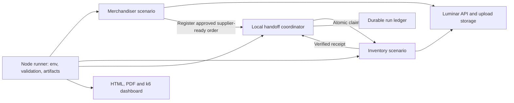
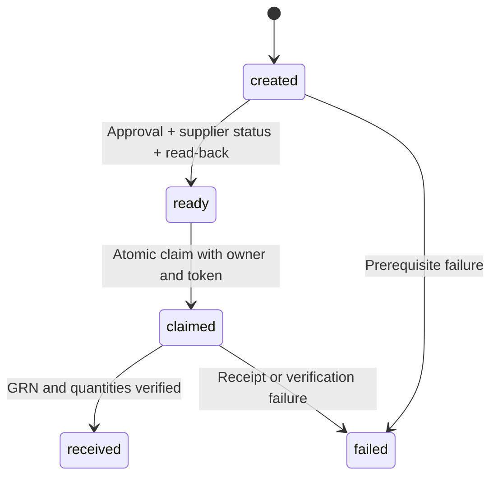

# Luminar Slice 1 — Load-testing implementation handoff

Prepared for the development team · 16 October 2026

This report describes the current local implementation, including changes after commit `0f360be`. It is an implementation handoff, not a capacity or release sign-off. No load test was executed to prepare it.

## 1. Scope and design decisions

The primary load profile runs Merchandiser and Inventory users independently and concurrently. Merchandisers create linked business records; Inventory users receive eligible work orders produced by the same run. Each business VU has a distinct assigned account and reuses its authenticated session.

| Decision | Implementation and reason |
| --- | --- |
| Independent concurrent roles | Two `ramping-vus` scenarios model producers and consumers progressing at different speeds. |
| Maximum 50 business VUs | The configured role counts must sum to the requested total, which cannot exceed 50. |
| Work-order approval only | Senior Merchandiser approves each work order and sends it to the supplier before receiving. BOM, costing and purchase-order approvals/submissions are excluded. |
| Receiving-only Inventory scope | Create and verify a GRN, confirm received quantities/status and one receipt. QC and stock-entry creation are excluded. |
| Real upload traffic | Techpack creation requests upload URLs, transfers the fixture files and creates the techpack record. |
| Separate latency budgets | Regular API traffic and techpack requests have different tagged acceptance thresholds. |
| Durable handoff | A local Node coordinator serializes claims and saves a per-run ledger; isolated k6 VUs do not share a mutable JavaScript queue. |
| No blind write retries | A timeout can hide a committed write. Failed or ambiguous receipts remain recorded for reconciliation. |

This is a concurrent-user workload: achieved request throughput depends on application latency, think time and available work. The separate legacy arrival-rate scenario is not the primary role profile described here.

## 2. Architecture and business journey



### Merchandiser workflow

| Step | Behavior and dependency |
| --- | --- |
| 1. Session | Use the assigned Merchandiser session; refresh at a safe boundary when required. |
| 2. Style | Create a unique style and retain its ID. |
| 3. Techpack | Request upload URLs, upload actual fixture files, then create the techpack for that style. |
| 4. Sample | Create a sample and verify its style relationship. |
| 5. BOM | Read the created style/combo, create a BOM and verify the linked style. |
| 6. Pre-costing | Create costing for the style; no approval submission. |
| 7. Purchase order | Create the PO for the same style/combo and verify its relationship. |
| 8. Work order | Read the created PO; derive matching garment sizes, color and quantities; reserve a new number and create the work order. |
| 9. Required approval | Use the existing Senior Merchandiser session to approve the work order, then set `SENT_TO_SUPPLIER`. |
| 10. Handoff | Read back status and style/PO relationships. Only then mark the registered order ready for Inventory. |

Approval is a supporting action within Merchandiser VUs. There is no extra approval scenario and no executive login. Multiple Merchandiser VUs can use the shared Senior Merchandiser account; its contention and authorization limits can affect results.

### Inventory workflow

| Step | Required verification |
| --- | --- |
| 1. Claim | Atomically claim one ready order from the current run. If none exists, wait and poll again. |
| 2. Read order | Confirm the registered order, style and purchase relationships; require `SENT_TO_SUPPLIER`. |
| 3. Validate items | Every variant must have a positive ordered quantity, a measurement unit and zero previously received quantity. |
| 4. Duplicate guard | List GRNs for the work order and require zero existing receipts. |
| 5. Receive | Send one GRN containing the full ordered quantities for every variant. |
| 6. Verify GRN | Validate the returned ID, order relationship, item identities, quantities and units; GET the GRN and validate again. |
| 7. Verify order | Poll safe GETs until the work order is `RECEIVED`, then check each variant's received quantity. |
| 8. Reconcile | Require exactly one GRN matching the created receipt; mark the claim received in the ledger. |

A completed Inventory iteration without a claim is an empty poll, not a completed receipt. Receiving verification proves the receipt and work-order updates; it makes no claim about QC or stock-entry creation.

### Claim lifecycle



The coordinator listens on loopback and uses a random per-run key. Each transition persists JSON through a temporary file and atomic rename before acknowledgment. Claims do not expire or return to the queue automatically. This prevents local concurrent reassignment; it is not distributed exactly-once delivery or backend idempotency. Process crash recovery/resuming a prior queue is not implemented.

## 3. Workload profiles and execution time

| Command | Merchandiser | Inventory | Total | Intended use |
| --- | --- | --- | --- | --- |
| `npm run test:roles:smoke` | 1 | 1 | 2 | One producer workflow; validate integration quickly. |
| `npm run test:loads:5` | 4 | 1 | 5 | Baseline. |
| `npm run test:loads:10` | 8 | 2 | 10 | Normal concurrent-user load. |
| `npm run test:loads:20` | 16 | 4 | 20 | Increased concurrency. |
| `npm run test:loads:50` | 40 | 10 | 50 | Maximum supported role load. |

| Timing setting | Smoke command | Normal 5/10/20/50 defaults |
| --- | --- | --- |
| Ramp up | 1 second | 2 minutes |
| Steady phase | 30 seconds | 15 minutes |
| Ramp down | 1 second | 2 minutes |
| Producer completion grace | 2 minutes | 10 minutes |
| Extra Inventory drain | 30 seconds | 5 minutes |
| Scheduled Merchandiser stages | 32 seconds | 19 minutes |
| Scheduled Inventory stages | 3 minutes 3 seconds | 36 minutes |
| Workflows per producer VU | Maximum 1 | Repeat while the producer window is open. |
| Human think-time scale | 0: disabled | 1: full ranges below. |
| Stop on workflow error | Enabled | Continue recording failures unless explicitly enabled. |

Inventory stays at its allocated concurrency during producer completion grace and drain, then ramps down. Setup, graceful completion, teardown and an open dashboard connection can extend wall time. The smoke command is not expected to end after its 30-second steady phase.

General `npm run test:roles` defaults to 10 VUs. A manually configured total of 2 outside the smoke command has a 10-minute steady default. `ROLE_MERCHANDISER_VUS` and `ROLE_INVENTORY_VUS` can override the allocation, provided their integer sum matches `ROLE_TOTAL_VUS` and the combined cap remains 50.

## 4. Think time and realistic pacing

After business actions, the scenario draws a uniform random delay within each range and multiplies it by `ROLE_THINK_SCALE`. This spreads requests and represents time spent reviewing or entering information. These assumptions require calibration against real usage; they are not recorded production user behavior.

| Trigger | Default delay | Purpose |
| --- | --- | --- |
| First assigned session / refreshed session | 2–5 seconds | Navigation after login. Not a fresh login before every workflow. |
| Style created | 15–45 seconds | Review style details. |
| Techpack created | 20–60 seconds | Review uploaded documents. File-transfer time is additional. |
| Sample created | 20–60 seconds | Sample information review. |
| BOM created | 30–90 seconds | Review material requirements. |
| Costing created | 20–60 seconds | Review prices and consumption. |
| Purchase order created | 15–45 seconds | Review order information. |
| Inventory discovered an eligible order | 5–20 seconds | Review receivable items before receiving. |
| No ready order / after workflow failure | 2 seconds | Poll/backoff interval; separate from human think time. |

The six producer action pauses total 120–360 seconds per workflow, excluding login, API calls, uploads and approvals. Inventory adds 5–20 seconds before receipt, plus any queue wait. Think time affects end-to-end duration and achieved throughput; it is not included in individual HTTP request latency.

Override a range with `ROLE_THINK_<STEP>_MIN` and `ROLE_THINK_<STEP>_MAX`, using `LOGIN`, `STYLE`, `TECHPACK`, `SAMPLE`, `BOM`, `COSTING`, `PURCHASE` or `DISCOVER`. For example, `ROLE_THINK_BOM_MIN=20 ROLE_THINK_BOM_MAX=60`. `ROLE_THINK_SCALE=0.5` halves human pauses; the smoke command sets it to zero. Queue polling remains enabled.

## 5. Acceptance thresholds and interpretation

| Gate | Default acceptance | Scope |
| --- | --- | --- |
| Regular API p95 | < 2 seconds | `traffic:application,workload:api`; includes work-order approval and supplier status. |
| Regular API p99 | < 5 seconds | Same regular API group. |
| Techpack p95 | < 30 seconds | `traffic:application,workload:techpack`: upload URL request, each file transfer and techpack create request. |
| Techpack p99 | < 45 seconds | Same techpack request group. |
| Application HTTP failure rate | < 1% | All application requests, including techpack/upload traffic. |
| End-to-end completion | ≥ 99% | Verified received workflows divided by every started producer workflow. |
| Minimum business activity | > 0 attempts and > 0 verified receipts | An empty/no-work run cannot pass. |
| Quantity violations | 0 | Recorded receiving quantity violations. |
| Data-integrity violations | 0 | Relationship and integrity checks. |
| Duplicate successful receipts | 0 | Verified duplicate GRNs. |
| Coordinator errors | 0 | Handoff service operations. |

These are provisional acceptance budgets, not agreed production SLOs. Percentiles are calculated over tagged request samples across the whole run; they are not per-endpoint gates or steady-state-only measures. A techpack request budget is not a budget for the combined multi-file workflow. Endpoint tables retain counts and timings to expose slow individual operations.

Setup authentication and local coordinator calls are excluded from application acceptance gates. Aggregate HTTP totals/rate include them; do not interpret total throughput as Luminar business throughput. Authentication failures still stop setup.

| Environment setting | Default |
| --- | --- |
| `ROLE_API_P95_MS` / `ROLE_API_P99_MS` | `2000` / `5000` |
| `ROLE_TECHPACK_P95_MS` / `ROLE_TECHPACK_P99_MS` | `30000` / `45000` |
| `ROLE_HTTP_FAILURE_RATE` | `0.01` |
| `ROLE_COMPLETION_RATE` | `0.99` |
| `ROLE_POLL_INTERVAL_SECONDS` / `ROLE_POLL_TIMEOUT_SECONDS` | `2` / `60` |
| `ROLE_SESSION_MAX_AGE_SECONDS` | `900` |

Latency inputs and raw k6 trends use milliseconds; the redesigned report displays seconds. Report generation does not reevaluate historical results using new targets: each saved run retains its own thresholds.

## 6. Authentication, fixtures and failure handling

The Node runner loads the existing root `.env`, with existing process values taking precedence. It validates required tenant/business IDs, selected account counts and duplicate selected identities before load. Business accounts are selected from declared `*_ACCOUNT_COUNT` / `*_ACCOUNT_<n>_*` pools, with the legacy `users.json` mappings supported as a fallback. The existing senior-merchandiser credentials support only the required work-order lifecycle.

Sessions are established sequentially in setup and reused. The role runner defaults to a 5-second inter-account delay. Authentication HTTP 429 responses can retry twice, respecting `Retry-After`; the fallback cooldown is 30 seconds, then 60 seconds, with a 120-second maximum accepted wait. These delays differ from simulated user think time. Sessions refresh after 900 seconds or invalidation, at a subsequent safe boundary. A failed write is never replayed merely because a token can be refreshed.

Purchase shipment dates come from `k6/data/purchase.json`: current date plus 30 calendar days in its configured UTC+6 business timezone. Purchase/work-order currency is validated. Work-order sizes, color and material quantities derive from the created PO and fixture consumption/wastage, with fresh IDs replacing linked fixture IDs. Other master-data references and dates, including the work-order delivery-date fixture, still require QA maintenance.

| Failure type | Behavior |
| --- | --- |
| Setup authentication failure | Cancel business load. |
| Business HTTP/contract failure | Stop that workflow, record step/category/status and known entity IDs. |
| Smoke workflow failure | Persist failure and abort the run through `ROLE_STOP_ON_ERROR=1`. |
| Safe GET transient/state delay | Bounded polling; no writes until required state checks succeed. |
| Create/approve/status/receive uncertainty | No automatic write retries. Reconcile saved IDs and application records. |
| No Inventory work | Wait and poll, without a failed receipt sample. |

Credentials, session tokens and raw response bodies are not included in shared failure reports. The known `FEATURE_DISABLED` code is retained; other HTTP 400 responses may currently require a sanitized focused diagnosis because the ledger stores status/category rather than the full validation message.

## 7. Reports and developer triage

Each run writes to its own `k6/results/<timestamp>-<scenario>-<id>/` directory. Complete report generation follows k6 process exit.

| Artifact | How developers use it |
| --- | --- |
| `report.html` | Summary cards, functional vs performance outcome, latency charts, slow endpoints, acceptance tables, checks and provenance. |
| `report.pdf` | Shareable assessment with cards, charts and evidence tables. |
| `summary.json` | Raw aggregate metrics and evaluated thresholds. |
| `metadata.json` | Scenario, timings, revision/dirty state, workload configuration and failure summary. |
| `handoff-ledger.json` | Started workflows, created entity IDs, claims, partial effects, verified receipts and backlog. |
| `k6-dashboard.html` | Redesigned report entry point when a native export was produced. |
| `k6-dashboard-native.html` | Preserved original k6 export for time-series inspection. |

The live dashboard uses the built-in k6 web dashboard on port 5665. A project layout avoids the observed blank-screen issue with late metric series. Close all live dashboard tabs after a run so k6 can exit and the runner can finish reporting. For unattended execution, use `K6_WEB_DASHBOARD_PORT=-1`; this disables the live HTTP server while retaining export generation when enough data exists.

Saved reports can be regenerated without executing k6:

```sh
npm run report:regenerate -- k6/results/<existing-run-directory>
```

Triage order: distinguish functional failure from latency failure; identify the exact failing step and HTTP status; inspect the ledger and linked records for partial writes; examine endpoint timings/sample counts; correlate timestamps with API, database, object-storage, CPU/memory and queue telemetry. HTTP success alone is insufficient. A successful receipt with failed latency targets remains an overall failed acceptance result.

## 8. Source map, verification and limitations

| File | Responsibility |
| --- | --- |
| `reporting/run.mjs` | Environment preflight, run directory, coordinator, dashboard, k6 process and final report orchestration. |
| `config/role-load.mjs` | Allocations, executors, stage timing, tags and thresholds. |
| `scenarios/load-roles.js` | Setup/authentication, scenario exports and final reconciliation metrics. |
| `flows/role-journeys.js` | Linked creation, work-order lifecycle, claim/receive/read-back flow. |
| `flows/tech-pack.js` | Real file transfers and separate techpack request tags. |
| `flows/work-order.js` | PO-derived payload, number reservation, work-order approval and supplier status. |
| `helpers/role-runtime.js` | Think-time ranges, session reuse, validation, GET polling and coordinator calls. |
| `helpers/role-accounts.mjs` | Credential-pool selection and distinct-identity checks. |
| `reporting/role-coordinator.mjs` | Serialized local assignments, atomic claims and durable ledger. |
| `reporting/presentation.mjs` | Structured HTML/PDF presentation and original dashboard preservation. |
| `tests/` | Unit, contract, parsing, report and local integration checks. |

Latest focused verification after restoring work-order approval: 19 offline tests passed and all 10 scenarios parsed without execution. The developer subsequently ran a smoke profile through its scheduled stages; stage completion alone does not prove reconciled workflow success or passing thresholds. This handoff makes no new live acceptance claim.

Known limits: one local coordinator/runner; no distributed queue or resume; persistent QA records and uploaded files with no complete teardown; fixed master data; shared supporting approval identity; human pauses are assumptions; whole-run aggregate metrics; small smoke samples cannot establish reliable tail behavior. The normal 10/20/50 profiles must be assessed from their own complete artifacts and server telemetry before any capacity conclusion.
